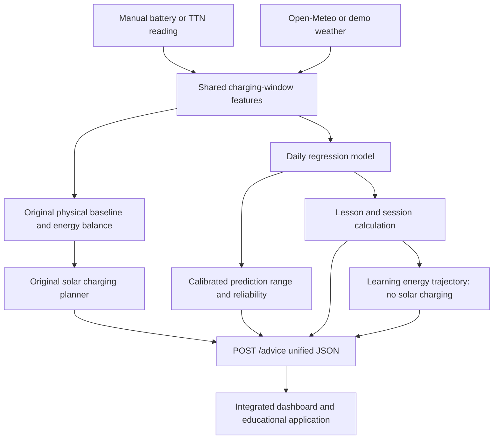

# Smart Energy AI | Complete A–Z workspace

Prime Power Solutions · Educational suitcase · Pretoria reference location

## 1. Start on Windows (VS Code)
Extract the ZIP, open the **Smart-Energy-AI** folder containing `config.json`, and open a PowerShell terminal. Python 3.12 is recommended. Use the single setup command:

```powershell
powershell -ExecutionPolicy Bypass -File .\start.ps1
```

The execution-policy override applies to this child PowerShell process only. The script creates a local virtual environment, installs dependencies, trains both demo models and starts one local FastAPI server. The first installation needs internet; demo training and prediction work offline afterward. Training may take a few minutes. Keep the terminal open. Open http://127.0.0.1:8000/ in your browser, not the HTML file.

Manual equivalent:

```powershell
py -3.12 -m venv .venv
.\.venv\Scripts\python.exe -m pip install -r requirements-dev.txt
.\.venv\Scripts\python.exe -m energy_ai train-all
.\.venv\Scripts\python.exe -m pytest -q
.\.venv\Scripts\python.exe -m energy_ai serve
```

After first setup, only the last command is needed to restart the server. If port 8000 is occupied, stop the previous server or use `--port 8001` and open that port. Model binaries are generated locally to avoid version incompatibilities. No real credentials or measurements are included.

## 2. How the two systems are connected



`integration.py` reuses `models.baselines`, `battery.advance` and `solar_planning.daily_solar_summary` with the daily model's **same** battery, weather and team hardware profile. The physical charging trajectory and the daily ML prediction are independent estimates; the gap is not an accuracy metric. The afternoon learning trajectory begins at the ML estimate and subtracts the assumed battery-side drain for each recommended lesson. It never adds solar energy during learning. The strongest sunlight and best stored-energy interval can differ if the battery fills early. Charge throughout available sunlight before 14:00; do not wait for the best hour if charging is possible now.

The original hourly research dashboard and `/api/forecast` remain available, with their original 500 Wh / 100 W assumptions. The integrated dashboard can pass its battery and weather scenario to that page, but the old forecast uses its own current-time horizon and legacy hardware, so it is not a directly comparable operational prediction. Do not use legacy recommendations for the suitcase.

## 3. Agreed working policy

| Parameter | Value |
|---|---|
| Learning window | 14:00–17:00 Pretoria local time |
| Lesson | 5 minutes |
| Session | 20 minutes / 4 lessons |
| Teacher cap | 8 full sessions / 32 lessons / 160 minutes |
| Unallocated time | 20 minutes minimum |
| Team battery / panel | 180 Wh / 25 W (unverified) |
| Assumed drain | 10 percentage points/session, 2.5 pp/lesson |
| End reserve | 10% (conservative assumption) |

The 11-hour charge and three-hour runtime are reported references, not verified test results. The integrated physical reference uses 80% solar derating, zero charging-mode load and 54 W battery-side learning load derived from the team drain. These are assumptions, not measurements. A five-minute lesson may be allocated even when a full session is not possible. Full sessions and extra lessons are reported separately. Recheck the actual battery before use.

## 4. API and frontend

| URL | Purpose |
|---|---|
| `/` or `/daily` | Integrated primary dashboard |
| `/energy` | Original hourly research dashboard |
| `POST /advice` | Unified battery, reliability, lessons, sessions and energy analysis JSON |
| `/api/daily/reliability` | Separate held-out reliability results |
| `/api/daily/metrics` | Full training evaluation |
| `/api/daily/config` | Teacher policy |
| `/api/lessons/actual?battery_pct=100` | Actual-battery estimate: 8 sessions / 32 lessons |
| `/api/battery/latest?device_id=...` | Latest fresh TTN reading |
| `/api/forecast` | Legacy hourly forecast |
| `/docs` | Interactive API documentation |

Example in a second PowerShell terminal:

```powershell
$body = @{battery_pct=41;weather_source='demo';scenario='sunny';prediction_hour=8} | ConvertTo-Json
Invoke-RestMethod -Method Post -Uri 'http://127.0.0.1:8000/advice' -ContentType 'application/json' -Body $body | ConvertTo-Json -Depth 20 | Set-Content -Encoding UTF8 advice.json
```

The new `energy_analysis` object includes hourly charging, potential and stored solar energy, best charging interval, and lesson-by-lesson learning trajectory. The `prediction_reliability` object contains calibrated range, test coverage and errors. The educational application can call this same endpoint; external integration is not yet tested.

## 5. Training and real data

`train-all` trains both demo pipelines. The daily model compares average gain, Linear Regression and Random Forest (direct and gain), tunes on chronological training folds, selects model/margin on validation days, calibrates on separate days and evaluates on untouched test days. Metrics are in percentage points and calculated lesson/session agreement. Coverage is observed on test days, not the probability of this individual prediction being correct.

Team CSV: place `device_sessions_hourly_mock_long.csv` in `data/`, then run `python -m energy_ai train-daily-team --csv data/device_sessions_hourly_mock_long.csv` using the venv. Select Team mock CSV in the dashboard. Their original CSV is not supplied. The included demo data is synthetic.

For live TTN setup, environment variables, logging, CSV export and real-data training, follow [DAILY_QUICKSTART.md](DAILY_QUICKSTART.md) and [DAILY_LEARNING_PLAN.md](docs/DAILY_LEARNING_PLAN.md). The listener uses TLS MQTT and stores observations in SQLite. No Raspberry Pi is required for the AI server. A functioning LoRaWAN gateway and TTN application are required. Keep the server on localhost unless a secure deployment is arranged.

## 6. Demonstration and limitations

Use simulated sunny/cloudy weather with 41% morning battery; compare lessons, prediction interval and energy trajectories. Try the actual battery calculator at 100% to verify the teacher cap. Show the original hourly research dashboard and the unified JSON in Swagger. See [DEMO_GUIDE.md](docs/DEMO_GUIDE.md) for teacher explanation. Real battery validation, actual team CSV, live TTN, actual weather forecast accuracy and external educational application integration are pending. This is advisory software, not a battery protection controller.
