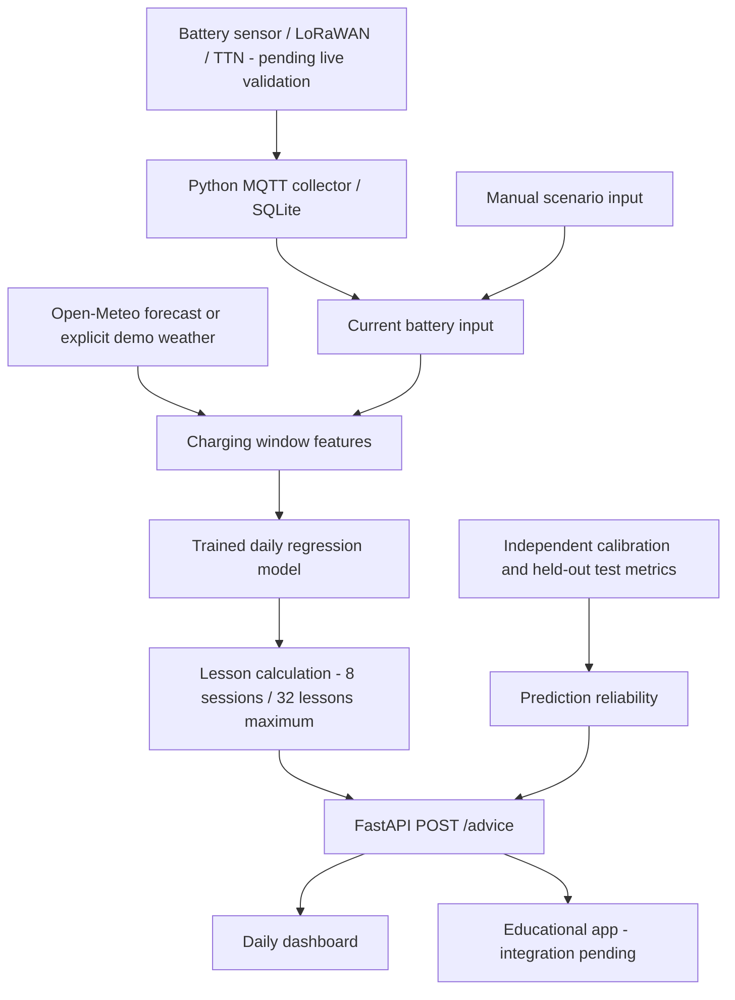

# Teacher feedback demonstration

## 1. What I built
I kept the original hourly energy research application, and made the daily learning planner the primary demonstration. The daily planner predicts battery at 14:00, then converts the predicted battery into learning capacity. It respects the latest limit of eight twenty-minute sessions or 32 five-minute lessons, with no charging during use. The 14:00–17:00 window leaves 20 minutes outside the maximum learning allocation.

## 2. Show the working application
Run `python -m energy_ai serve` after training both demo models. Open `/daily`. Select manual battery 41%, simulated weather, 08:00, sunny. For the build demonstration date (25 November 2026), the forecast is 87.23%, 28 lessons, seven complete sessions, 140 minutes. Switch to cloudy: 60.94%, 18 lessons, four complete sessions plus two lessons, 90 minutes. These values may vary with the date. Set battery to 100% and verify the hard cap: 32 lessons, eight sessions, 160 minutes. At the actual-battery recheck, enter 100% and verify the same cap. The eight session slots show full, partial or unused allocations. Extra lessons are already included in the total, not additional to it.

## 3. Explain the AI and its added value
The baseline estimates average gain per hour. Linear Regression and Random Forest learn from weather and battery data. The direct and gain approaches are compared. We use a chronological split of 219 training, 36 selection, 37 calibration and 73 test days. TimeSeriesSplit tunes forest settings within training days. Model and advice margin are selected on validation data, not test. The selected Random Forest predicts the battery directly; arithmetic calculates lessons and sessions. The 08:00 test MAE is 2.55 percentage points versus 10.25 for the baseline (75.2% lower). The model is not guaranteed to be better on real data.

## 4. Explain reliability
A separate calibration set determines the prediction range. For a nominal 90% interval, 67 of 73 held-out simulated 08:00 outcomes fell within it (91.8% observed coverage). This is not the probability of a specific forecast being correct. MAE measures average battery error; exact session advice was 43/73 (58.9%), excessive advice 1/73 (1.4%), too few 29/73 (39.7%). The five-point margin reduces over-advice but can lose learning time. All these results compare simulated battery outcomes and calculated capacity, not real completed lessons.

## 5. Show the software architecture

Training is separate from inference. `daily.py` implements the model, evaluation, policy and prediction; `api.py` exposes JSON; `daily_dashboard.html` renders advice, reliability and graphs; `telemetry.py` receives and stores decoded messages. The original hourly dashboard and endpoints remain available as research, with their original different assumptions.

## 6. Show the API
Open `/docs`, run POST `/advice`, and show the learning counts, `max_sessions`, `max_lessons`, `prediction_reliability`, and source fields. Open `/api/daily/reliability?prediction_hour=8` for separate evaluation output and `/api/daily/config` for the learning policy. See `example_advice.json` and `example_reliability.json` for captured demo responses.

## 7. Value proposition / AI business model canvas notes
- Users: learners, teachers and device custodians in communities with limited electricity.
- Value: plan learning around variable sunlight, communicate capacity as lessons rather than watts, and avoid over-promising learning time.
- Data: current battery SoC, charging state, weather forecasts, timestamps, verified lesson consumption. The real data is not yet available.
- Partners: hardware team, educational software team, Prime Power Solutions, and local users.
- Resources and costs: solar hardware, gateway connectivity, backend hosting, data collection and maintenance.
- Success measures: battery MAE, interval coverage, too many/few lessons, learning interruptions and user comprehension. The last two require field evaluation.
- Risks: forecast errors, unreliable connectivity, inaccurate SoC, battery degradation and unequal access. Recheck actual battery before use; hardware protection remains independent.

## 8. What remains
Receive the actual TTN payload, confirm device ID and battery field, measure charging/discharging, verify 180 Wh / 25 W and 10 pp per session, collect diverse charging days, train and calibrate using real data, and validate with the educational application. The teammate's original CSV was not supplied; the project can import it using `train-daily-team`. Do not present the simulated metrics as real hardware accuracy.
